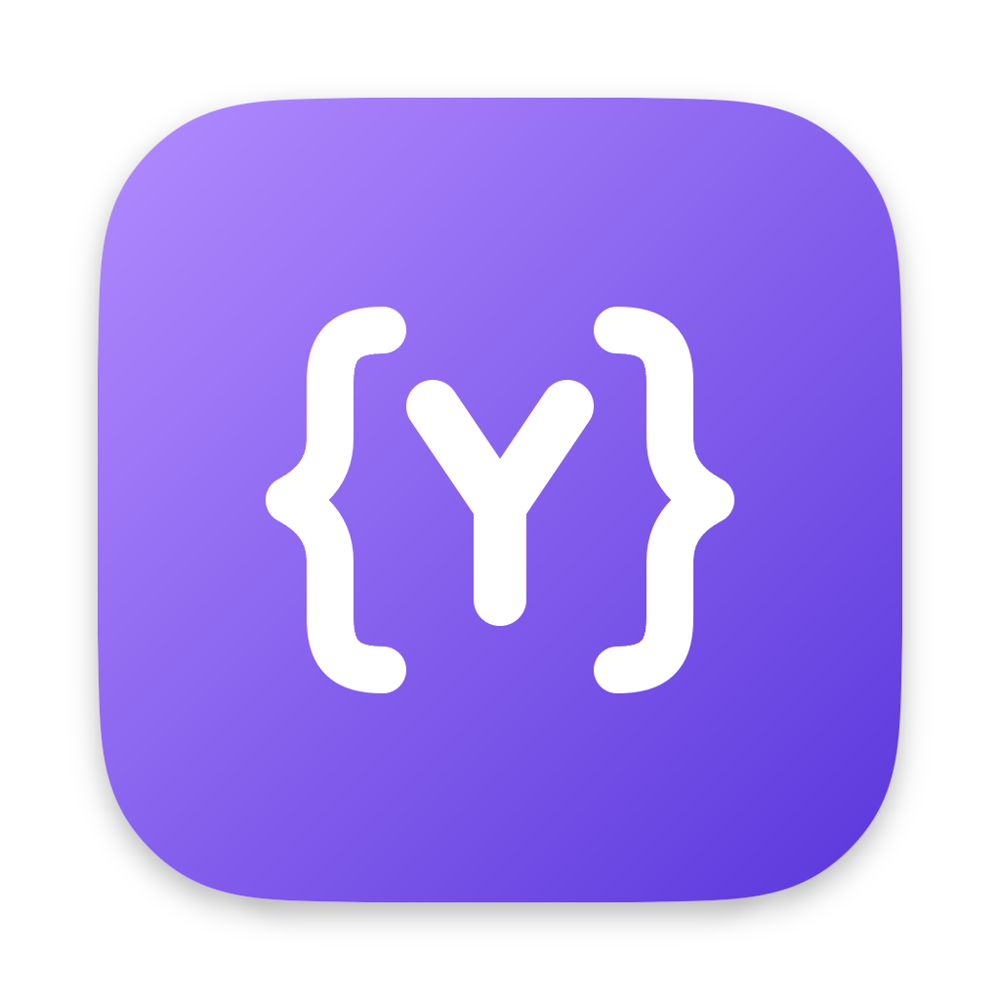

<p align="center">
  
</p>

<h1 align="center">Yeek</h1>

<p align="center">
  A native, cross-platform API client for HTTP, GraphQL, gRPC and WebSocket, written entirely in Go.
</p>

<p align="center">
  <a href="https://github.com/tacshi/Yeek/releases/latest"></a>
  <a href="LICENSE"></a>
  
  
</p>

---

Yeek is a desktop API client built with [MyGo](https://github.com/egoist/mygo). Every screen is drawn by MyGo's native Go UI toolkit, including the code editor, the sidebar tree, dialogs and menus. There is no bundled browser engine, and no JavaScript runtime drives the interface. The system web view is used only to preview HTML, PDF and media responses and for OAuth sign-in, each in a sandbox. The protocol clients, template engine, importers, filesystem sync and Git integration are all plain Go.

> [!NOTE]
> Yeek is under active development. Expect frequent releases. Storage formats are kept backward compatible, but the UI and the plugin API may still change.

## Contents

- [Features](#features)
- [Installation](#installation)
- [Building from source](#building-from-source)
- [Usage](#usage)
- [Plugins](#plugins)
- [Development](#development)
- [Releasing](#releasing)
- [Contributing](#contributing)
- [License](#license)

## Features

### Requests

- **HTTP:** custom methods, query parameters, headers, and URL-encoded, multipart, JSON, XML, text and binary-file bodies. Multipart fields can carry files, custom filenames and their own Content-Type.
- **GraphQL:** schema introspection, or a schema loaded from an SDL or introspection JSON file. The editor completes fields, arguments, variables and fragments, checks queries and variables as you type, and includes a documentation explorer.
- **gRPC:** unary, client-streaming, server-streaming and bidirectional calls, with server reflection or your own `.proto` files.
- **WebSocket:** persistent connections with a message log and a hex dump view for binary frames.
- **Responses:** pretty and raw views, JSONPath and XPath filtering, response history with pinning, a timeline of each exchange, and previews for HTML, PDF, images, audio, video, CSV and server-sent events.

### Workspaces

- **Environments:** base and sub-environments, folder-level variables, colors, and sharable or private environments.
- **Inheritance:** headers, authentication and request settings flow from the workspace to its folders to each request.
- **Templates:** variables and functions such as `${[ uuid.v4() ]}`, `${[ response.body.path(...) ]}` and `${[ prompt.text(...) ]}`. Tags render as chips and open a form with a live preview.
- **Cookies:** jars per workspace, and an editor for every cookie attribute.
- **Encryption:** secrets are encrypted per workspace with a key kept in the operating system's keychain, and stored with the `secure()` template function.

### Authentication

Basic, Bearer, API key, Digest, NTLM, JWT, AWS Signature V4, OAuth 1.0, and OAuth 2.0. OAuth 2.0 covers the authorization code (with PKCE), implicit, client credentials, password and refresh-token grants. Sign-in runs in a dedicated window or in the system browser.

### Networking

Client certificates (PEM, encrypted PKCS#8, PFX/PKCS#12) scoped by host and port, extra certificate authorities, DNS overrides, and HTTP, HTTPS and SOCKS5 proxies with authentication and bypass rules.

### Import, export and sync

- **Import:** Postman, Insomnia, OpenAPI 3.x, Swagger 2.0, Bruno, cURL commands, and Yeek exports. Imports are previewed before they apply, and a linked source can be imported again with per-resource selection and conflict resolution.
- **Export:** one or more workspaces as JSON.
- **Filesystem sync:** keeps a workspace in a directory as one YAML file per resource, ready to commit.
- **Git:** commit, push, pull, branch, merge, view history, and restore files, without leaving the app.

### Also

- **Command palette:** quick switching between requests, environments and workspaces.
- **Keyboard shortcuts:** every shortcut can be remapped.
- **Themes:** built-in light and dark themes, themes from plugins, and your own font choices.
- **Languages:** English, Simplified Chinese (简体中文), Japanese (日本語) and Korean (한국어).
- **AI agents:** a built-in [Model Context Protocol](https://modelcontextprotocol.io) server lets coding agents such as Claude Code, Codex and Cursor read, edit and send your requests.
- **Updates:** automatic updates, signed and delivered from GitHub Releases.

## Installation

Download the latest release from the [Releases page](https://github.com/tacshi/Yeek/releases/latest).

| Platform | File |
| --- | --- |
| macOS (Apple silicon) | `Yeek.<version>.arm64.dmg` |
| macOS (Intel) | `Yeek.<version>.amd64.dmg` |
| macOS (universal) | `Yeek.<version>.dmg` |
| Windows (x64) | `Yeek.Setup.<version>.amd64.exe` |
| Windows (ARM64) | `Yeek.Setup.<version>.arm64.exe` |

macOS builds are signed and notarized. The Windows installers install for the current user. They are not code-signed yet, so SmartScreen may ask you to confirm before running them. On both platforms Yeek updates itself.

## Building from source

Requirements:

- Go 1.27.1 or newer
- Git, for Git sync features at runtime

```sh
git clone https://github.com/tacshi/Yeek.git
cd Yeek
go run .
```

Yeek builds without cgo. To produce an app bundle:

```sh
go tool mygo build -skip-dmg   # writes build/darwin-arm64/Yeek.app on Apple silicon
```

`go tool mygo build` also accepts `-platform` to build for other targets. During development, `go tool mygo dev` rebuilds and relaunches the app as files change.

## Usage

### Data directory

Workspaces, settings and request history are stored in SQLite in the platform's application data directory. Response bodies are stored next to it. To keep a separate set of data, for example for testing, start Yeek with another directory:

```sh
go run . --data-dir /path/to/data
```

### Language

Yeek follows the system language by default. To pick another one, open **Settings → Interface → Language**.

### Keyboard shortcuts

| Action | macOS | Windows |
| --- | --- | --- |
| Send request | `⌘ ↩` | `Ctrl+Enter` |
| Command palette | `⌘ K` | `Ctrl+K` |
| New request | `⌘ N` | `Ctrl+N` |
| Switch request | `⌘ P` | `Ctrl+P` |
| Edit environments | `⌘ ⇧ E` | `Ctrl+Shift+E` |
| Focus URL | `⌘ L` | `Ctrl+L` |
| Find / replace in editor | `⌘ F` / `⌘ ⌥ F` | `Ctrl+F` / `Ctrl+Alt+F` |
| Go to line | `⌃ G` | `Ctrl+G` |
| Settings | `⌘ ,` | `Ctrl+,` |

**Settings → Shortcuts** lists every shortcut and lets you remap them.

### Connecting AI agents

Turn on **Settings → Agents → Enable MCP server**. While Yeek is open, it then serves its tools at `http://127.0.0.1:64343/mcp`. The same page shows the setup snippet and access token for Claude Code, Codex, Cursor, VS Code and other MCP clients.

## Plugins

Plugins are Go source files that Yeek loads at runtime. A plugin exports a `Plugin` variable of type `plugin.Definition`. It can contribute template functions, authentication types, request and response hooks, actions, importers, response filters and themes. The full API is in [`plugin/plugin.go`](plugin/plugin.go).

```go
package extension

import (
	"strings"

	"yeek/plugin"
)

var Plugin = plugin.Definition{
	Name:    "Text Tools",
	Version: "1.0.0",
	Templates: []plugin.Template{{
		Name:        "text.upper",
		Description: "Convert text to upper case",
		Fields:      []plugin.Field{{Name: "value", Label: "Value"}},
		Run: func(ctx plugin.Context, args map[string]string) (string, error) {
			return strings.ToUpper(args["value"]), nil
		},
	}},
}
```

Load the file from **Settings → Plugins**, then use the function anywhere a template is accepted:

```text
${[ text.upper(value='hello') ]}
```

> [!WARNING]
> Plugins run with the same access to your files and network as Yeek itself. Only load plugins you trust.

## Development

### Project layout

| Path | Contents |
| --- | --- |
| `main.go` | Application entry point, menus and window management |
| `internal/desktop` | The user interface: views, dialogs, editors and settings |
| `internal/engine` | Storage, protocol clients, templates, auth, importers, sync and Git |
| `internal/filter` | JSONPath and XPath response filtering |
| `internal/mcp` | The Model Context Protocol server |
| `plugin` | The public plugin API |
| `locales` | Translation catalogs; `catalog_gen.go` is generated from them |
| `cmd/fixture` | A local test server for every supported protocol |
| `cmd/icon` | Generates the app icons |
| `third_party` | Vendored MyGo UI extensions, PDF.js, and third-party licenses |

### Testing and checks

```sh
go test ./...   # unit tests and headless UI tests
make check      # gofmt, golangci-lint, govulncheck and gosec
make clean      # remove build output
```

UI tests run against MyGo's headless tester. They click, type and render without opening a window, so they run wherever `go test` does.

### Local test server

```sh
go run ./cmd/fixture
```

This starts loopback endpoints for HTTP, cookies, redirects, WebSocket, server-sent events, GraphQL, images, CSV and gRPC (ports 9840 and 9841). Add `-tls-dir /path/to/keys` to generate throwaway certificates and serve an mTLS endpoint on port 9842. The generated client PFX uses the passphrase `fixture-pass`.

### Translations

User-facing text lives in `locales/<language>.json`, with English (`en.json`) as the source. After you edit a catalog, regenerate the accessors and check the catalogs:

```sh
go tool mygo generate
go tool mygo i18n check
```

To add a language, add a catalog named after its BCP 47 tag, for example `locales/de.json`.

### Debug builds

On macOS, `scripts/mac-debug.sh` builds `build/debug/Yeek Debug.app`. It has its own bundle identifier, data directory and icon, so it runs alongside a release install. Pass `--open` to launch it after the build.

## Releasing

Maintainers publish releases from a Mac.

| Script | Purpose |
| --- | --- |
| `scripts/mac-release.sh [version]` | Signed, notarized macOS disk images (arm64, x64, universal). Requires `DEVELOPER_ID_APPLICATION` and a `notarytool` keychain profile (`Yeek` by default, or set `YEEK_NOTARY_PROFILE`). |
| `scripts/win-release.sh [version]` | Windows installers for x64 and ARM64, cross-built with NSIS (`brew install makensis`). `scripts/win-release.ps1` does the same on Windows. |
| `scripts/publish.sh <version>` | Builds both platforms, uploads to a draft release, tags the commit and publishes. Notes come from `release-notes/Yeek-<version>.md`, or are drafted from the commits since the last tag. |

Updates are signed with the key from `go tool mygo keygen`. Its public half is `updates.publicKey` in `mygo.json`.

## Contributing

Bug reports, feature requests and pull requests are welcome. [Open an issue](https://github.com/tacshi/Yeek/issues) to discuss larger changes before starting on them.

Before opening a pull request:

1. Run `go test ./...` and `make check`.
2. Add tests for behavior changes. UI changes can be tested headlessly.
3. Put new user-facing text in `locales/en.json`, and add translations where you can.

## License

Yeek is released under the [MIT License](LICENSE).

It is built on [MyGo](https://github.com/egoist/mygo) (MIT). Notices and licenses for the third-party code it includes are in [`third_party/`](third_party), and the licenses of its Go dependencies are in [`third_party/DEPENDENCY_LICENSES.txt`](third_party/DEPENDENCY_LICENSES.txt). All of them ship inside the app.
